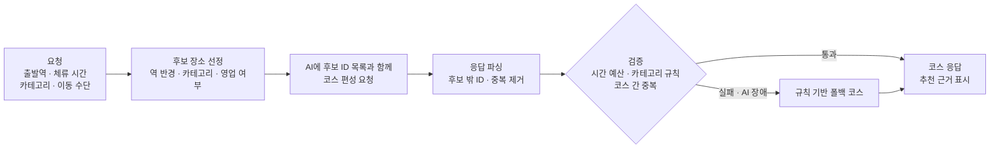
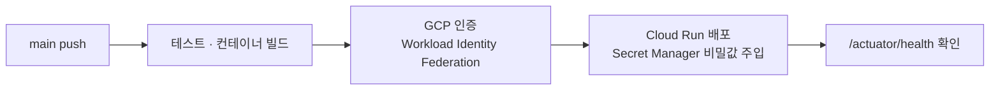

# Layover Backend

> 대전 환승 여행 코스 추천 서비스 [Layover](https://github.com/yonheeee/Layover)의 Spring Boot 백엔드

프로젝트 소개, 화면, 전체 구성은 **[Layover 저장소](https://github.com/yonheeee/Layover)** 에 정리했습니다. 이 문서는 백엔드 설계와 제가 맡은 부분을 자세히 다룹니다.

- 🌐 API: Google Cloud Run · 프론트: <https://layover-frontend.pages.dev>
- 🙋 **담당: AI 코스 검증 규칙 · 경로/교통 API · 클라우드 배포와 CI/CD · Docker 로컬 실행 환경**

<br>

## 기술 스택

| 구분 | 기술 |
| --- | --- |
| Language · Framework | Java 21, Spring Boot 4.1, Spring Security(JWT), MyBatis |
| Data | TiDB Cloud(운영) · MySQL 8.4(로컬), Upstash Redis, AWS S3 |
| External API | OpenAI(gpt-4o-mini), Tmap 경로, 카카오(로그인 · 모빌리티), 한국관광공사 TourAPI, TAGO 열차, 대전 버스, 기상청 |
| Infra | Google Cloud Run, Secret Manager, Workload Identity Federation, GitHub Actions, Docker Compose |

## 패키지 구성

| 영역 | 패키지 |
| --- | --- |
| 코스 추천 · 경로 | `course`, `tmap`, `kakao`, `bus`, `train`, `weather` |
| 관광지 | `place`, `bookmark` |
| 스탬프 · 캐릭터 | `stamp`, `character` |
| 커뮤니티 · 채팅 | `community`, `chat`, `report` |
| 회원 · 인증 | `user`, `signup`, `login`, `auth`, `find` |
| 고객 지원 | `notice`, `faq`, `inquiry` |

<br>

## 내 역할 상세

### 1. AI 코스 추천 검증

AI(gpt-4o-mini)에게 코스 편성을 맡기되, **응답을 그대로 믿지 않고 서버 규칙으로 검증 · 보정한 코스만 내보냅니다.**



**제가 구현한 부분**

- **AI 응답 파싱** — 프롬프트에 후보 장소 ID 목록을 주고, 응답에서 후보에 없는 ID와 중복 ID를 버리고, 필요한 개수만 남깁니다. AI가 존재하지 않는 장소를 지어내도 코스에 들어가지 않습니다.
- **시간 예산 계산** — `역 → 장소들 → 역` 전체 이동 시간과 카테고리별 체류 시간을 합칩니다. 좌표 간 직선거리(하버사인)에 도로 우회 보정 1.3배를 곱하고, 도보 4km/h · 차량 28km/h로 환산합니다.
- **검증 규칙** — 장소 수 부족, 중복 장소, 사용자가 고정한 장소 누락, 시간 초과를 탈락시킵니다. 같은 카테고리 연속 금지, 식사 1회 · 카페 2회까지라는 카테고리 규칙도 확인합니다.
- **시간 맞추기** — 시간을 넘는 코스는 뒤에서부터 장소를 하나씩 빼서 맞춥니다. 사용자가 고정한 장소는 빼지 않습니다.
- **코스 저장 · 재생성 API** — 추천받은 코스를 저장 · 조회 · 삭제하고, 일부 장소를 고정한 채 나머지만 다시 추천받는 API입니다.

<sub>AI 연속 실패 시 호출을 잠시 멈추는 차단기(circuit breaker)와 폴백 코스 생성 흐름은 팀원(윤선민)이 구현했습니다.</sub>

### 2. 경로 · 교통 API 연동

- **Tmap 경로 (`TMapApiClient`)** — 도보 · 차량 경로를 조회해 소요 시간, 택시 요금, 지도에 그릴 경로 좌표를 함께 돌려줍니다. 조회에 실패하면 실패 결과 객체를 돌려줘 상위 로직이 추정값으로 넘어가게 했습니다.
- **대전 버스 (`BusApiClient`)** — 대전시 버스 노선별 정류장 API를 불러 정류장 정보를 메모리에 캐시합니다.
- **역 기준 장소 적재 (`StationPlaceSeeder`)** — 대전역 · 서대전역 · 신탄진역을 코스의 출발 · 복귀 지점으로 쓰기 위해 서버 시작 시 장소 데이터로 넣습니다.

### 3. 클라우드 배포와 CI/CD



- **키 파일 없는 인증** — GitHub Actions가 서비스 계정 키 JSON 없이 OIDC 토큰으로 GCP에 인증합니다(Workload Identity Federation). 저장소나 GitHub Secrets에 장기 키가 남지 않습니다.
- **비밀값 분리** — DB · Redis 비밀번호와 AWS 키는 Secret Manager에서 환경변수로, 나머지 비밀 설정은 파일로 마운트합니다. 코드와 이미지에는 비밀값이 들어가지 않습니다.
- **서버리스에 맞춘 설정** — 인스턴스 0~2대, 인스턴스당 동시 요청 40, 메모리 1GiB로 비용을 줄였습니다. TiDB 서버리스 연결 수에 맞춰 커넥션 풀을 최대 5로 줄였고, 종료 시 20초 graceful shutdown, DB · Redis를 포함한 readiness 헬스체크를 설정했습니다.
- **CORS** — 운영에서는 Cloudflare Pages 프론트 주소만 허용합니다.

### 4. Docker 원클릭 로컬 실행

`start-layover.cmd`를 실행하면 프론트엔드(nginx) · 백엔드 · MySQL을 한 번에 띄웁니다.

- Docker Desktop이 꺼져 있으면 켜고, 엔진이 준비될 때까지 기다립니다.
- 환경 파일이 없으면 예제로 만들고, 프론트 `.env`의 카카오 키를 가져와 빌드에 넘깁니다.
- 웹 페이지가 실제로 응답할 때까지 확인한 뒤 브라우저를 엽니다. 종료해도 DB와 업로드 파일은 볼륨에 남습니다.

자세한 사용법은 [DOCKER.md](DOCKER.md)에 있습니다.

<br>

## 트러블슈팅

### TiDB에서 채팅방 목록이 항상 500

- **증상** — 로컬(MySQL)에서는 되던 채팅방 목록 API가 운영(TiDB)에서는 항상 500을 반환했습니다.
- **원인** — 방마다 최신 메시지를 붙이려고 `LEFT JOIN ... ON lm.id = (SELECT ... LIMIT 1)`처럼 ON 조건 안에 서브쿼리를 썼는데, TiDB는 이를 지원하지 않습니다(`ON condition doesn't support subqueries yet`).
- **해결** — `ROW_NUMBER() OVER (PARTITION BY room_id ORDER BY created_at DESC)`로 방별 최신 메시지 한 건을 미리 뽑은 파생 테이블을 만들고, `room_id`로 단순 등치 조인하도록 바꿨습니다.
- **배운 점** — "MySQL 호환" DB라도 지원 범위가 다르므로, 운영 DB에서 쿼리를 직접 검증해야 합니다.

### 운영에서 Redis 설정이 적용되지 않음

- **증상** — Cloud Run에 Upstash Redis 주소와 비밀번호를 `REDIS_HOST` 같은 환경변수로 넣었는데도 운영에 반영되지 않았습니다.
- **원인** — 이 값들은 `application.properties`의 `${REDIS_HOST}` 자리표시자로만 들어가는데, 추가로 마운트한 비밀 설정 파일에 있는 `spring.data.redis.*` 값이 그보다 우선 적용됐습니다.
- **해결** — Spring이 설정 파일보다 우선하는 OS 환경변수 이름(`SPRING_DATA_REDIS_HOST`, `..._PASSWORD`, `..._USERNAME`, `..._SSL_ENABLED`)으로 바꿔 배포 설정이 최종 값이 되게 했습니다. Upstash가 요구하는 ACL 사용자명과 TLS도 함께 설정했습니다.

### 탈퇴한 계정으로 재가입 · 재로그인이 막힘

- **원인** — 탈퇴해도 `email`, `kakao_id`가 그대로 남아 유니크 제약에 걸렸습니다.
- **해결** — 탈퇴 시 `kakao_id`는 `NULL`로, `email`은 `deleted_<userId>@deleted.local`로 바꿔 같은 계정으로 다시 가입할 수 있게 했습니다.

### 운영에서 사진 업로드 실패 원인을 알 수 없음

- **원인** — S3 저장 실패 예외를 응답 메시지에만 담고 서버 로그에는 남기지 않았습니다.
- **해결** — 실패 시 `log.error`로 원인을 남겨 Cloud Logging에서 AWS 권한 · 버킷 설정 문제를 추적할 수 있게 했습니다.

<br>

## 실행

```bash
# Docker로 프론트 · 백엔드 · MySQL 한 번에 (Layover와 같은 폴더에 둘 것)
start-layover.cmd

# 백엔드만
./mvnw spring-boot:run
```

필요한 환경변수는 [`.env.docker.example`](.env.docker.example)과 [`docs/cloud-run-env.example`](docs/cloud-run-env.example)을 참고하세요.

## 문서

- [Docker 통합 실행](DOCKER.md)
- [배포 구성](docs/DEPLOYMENT.md)
- [팀 Git 협업 가이드 (이클립스)](docs/git-collaboration-guide.md)

## 팀원

| 이름 | GitHub | 역할 |
| --- | --- | --- |
| 윤선민 | [@seonmin-S2](https://github.com/seonmin-S2) | Frontend · Backend |
| **김연희** | [@yonheeee](https://github.com/yonheeee) | **Frontend · Backend · Infra** |
